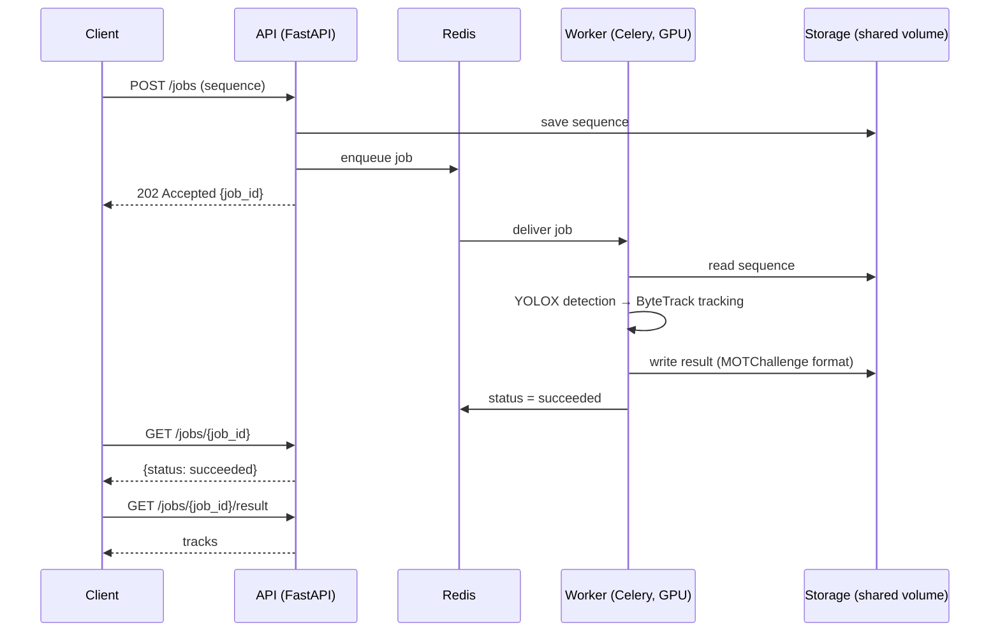
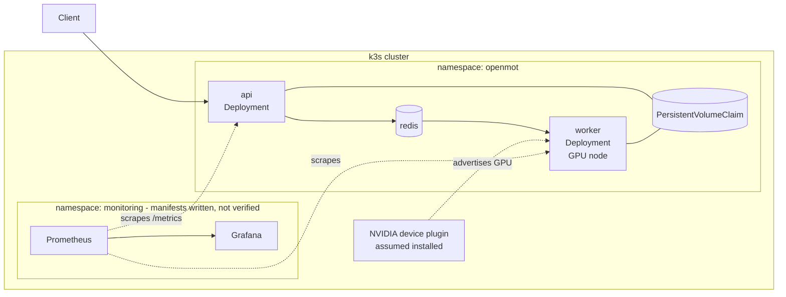
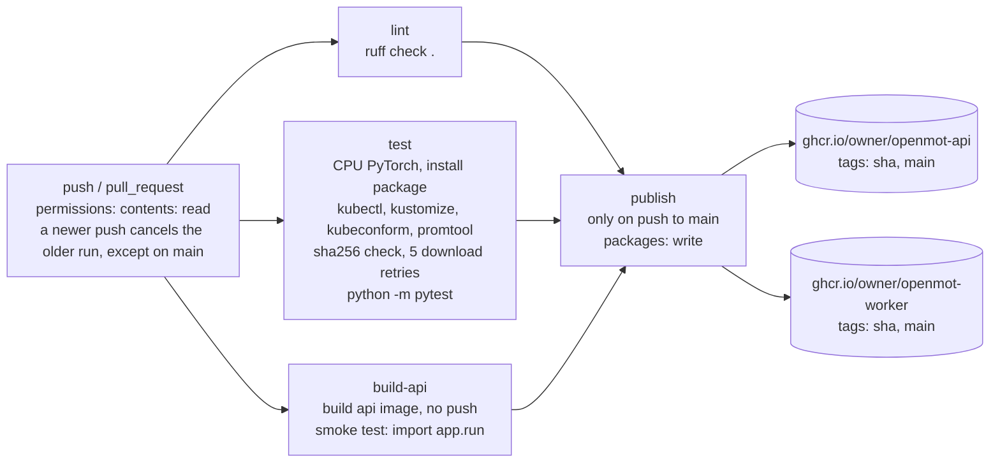

# openmot-serve

[English](README.md) | 繁體中文

把多目標追蹤（Multi-Object Tracking，MOT17／MOT20）做成可上線的服務：FastAPI + Docker + Kubernetes + CI/CD，並以 HOTA 評估。

> **目前狀態：v0.2 完成；v0.3 進行中——Kubernetes manifests 已寫好，但尚未在真實叢集上驗證；v0.4 CI 與可觀測性（observability）完成——CI workflow 與 GHCR 發佈都已在 GitHub 上跑過；指標（metrics）、Prometheus／Grafana 的 compose overlay 與警報規則已端對端驗證，只有 worker 例外（需要 GPU）；v0.5 推論最佳化完成——偵測器也能跑在 ONNX Runtime 與 TensorRT 上，INT8 量化已量測但不建議採用（HOTA 1.51，低於 FP16）；它已透過 Compose 的 TensorRT worker 端對端服務過，GPU 記憶體也量過（Kubernetes 沒有 TensorRT 映像）。** 追蹤管線與基準測試（v0.1）沒有改變：`python -m eval.run` 在 MOT17 的 Tuning Half 調參，並在 Validation Half 回報 HOTA／MOTA／IDF1（見 [`docs/evaluation.md`](docs/evaluation.md)）。在它之上，HTTP API、Celery GPU worker 與 Docker Compose 堆疊都已運作；API、容器部署與端對端結果見 [`docs/service.md`](docs/service.md)。Kubernetes manifests（kustomize base 與 k3s 單節點 overlay）只通過 render 與 schema 測試；當時沒有可用的 k3s 叢集，所以部署、GPU 排程與 Pod 復原都還沒驗證。[`docs/kubernetes.md`](docs/kubernetes.md) 有前置條件、部署步驟，以及在外部叢集上驗證它們的操作手冊（runbook）。GitHub Actions workflow（每次 push 都跑 lint、測試與 api 映像建置）已在 GitHub 代管的 runner 上跑過並通過；從 `main` 發佈映像到 GHCR 成功跑過一次（job 日誌確認已推送，但映像尚未拉回來驗證）。[`docs/ci.md`](docs/ci.md) 說明各個 job 與如何在本機重現。[`docs/observability.md`](docs/observability.md) 說明指標、Prometheus 與 Grafana 的 compose overlay 以及警報規則。worker 的指標只在行程內測試過（worker 需要 GPU，當時沒有），警報門檻與儀表板都沒有用真實流量校準，Kubernetes 的監控 manifests（ServiceMonitor、PrometheusRule）也只通過 render 與結構測試，沒有在真實叢集上驗證。worker 以 `OPENMOT_BACKEND` 選擇偵測後端（`torch`、`onnx` 或 `tensorrt`）；engine 用 `inference/` 與 `eval.latency` 建置與比較，前後對照數字見 [`docs/evaluation.md`](docs/evaluation.md)。TensorRT worker 映像只存在於 Docker Compose；Kubernetes manifests 跑的是 PyTorch 後端。設計決策在 [`docs/adr/`](docs/adr/)；領域用語定義在 [`CONTEXT.md`](CONTEXT.md)。

## 這個專案展示什麼

| 面向 | 佐證 |
|---|---|
| 可重現的評估 | 在 MOT17 Validation Half 上的 HOTA／MOTA／IDF1，一個指令即可重跑 |
| 模型服務（Model serving） | 以 FastAPI、Celery 與 Redis 實作的非同步追蹤任務 API |
| 容器與 Kubernetes | Docker 映像與 k3s manifests，含 NVIDIA GPU 排程 |
| CI/CD | GitHub Actions：每次 push 都 lint、測試並建置映像 |
| 可觀測性（Observability） | 以 Prometheus 指標與 Grafana 儀表板呈現延遲、吞吐量與任務失敗 |
| 推論最佳化 | PyTorch、ONNX 與 TensorRT 後端；INT8 量化附前後延遲與 HOTA 對照（已量測，判定為不建議） |
| 工程判斷 | 為了授權相容性而選的偵測器（[ADR-0001](docs/adr/0001-detector-yolox-for-license.md)） |
| LLM 應用 _（規劃中）_ | 透過本機 LLM 的工具呼叫（tool calling），對追蹤結果做自然語言查詢；模型選型沒有找到通過門檻的本機候選（[報告](docs/llm-selection.md)）；目前沒有任何服務上線 |

## 運作方式

用戶端把一段**序列**（sequence，編號影格的 zip）當成**追蹤任務**（tracking job）提交。API 儲存序列並把任務排入佇列。GPU worker 用 **YOLOX** 偵測人，用 **ByteTrack** 把偵測串成**軌跡**（track），並以 MOTChallenge 格式寫出**結果**。用戶端輪詢任務直到成功，再下載結果。



## 部署架構 _（v0.3 manifests 已寫好但尚未驗證；Kubernetes 監控 manifests 已寫好，未在叢集上驗證）_



| 元件 | 選擇 | 備註 |
|---|---|---|
| API | FastAPI | 非同步任務提交與輪詢 |
| 佇列 | Celery + Redis | 每個序列一個任務 |
| 偵測器 | YOLOX，COCO 預訓練權重 | Apache-2.0，見 ADR-0001 |
| 推論後端 | PyTorch（預設）、ONNX Runtime、TensorRT | 用 `OPENMOT_BACKEND` 與 `OPENMOT_PRECISION` 選擇；TensorRT worker 映像只在 Compose，Kubernetes 用 PyTorch |
| 追蹤器 | ByteTrack | MIT |
| 儲存 | Kubernetes PersistentVolumeClaim（k3s `local-path`，單節點） | Compose 可選用相容 S3 的後端（`OPENMOT_STORAGE_BACKEND=s3`，見 [`docs/service.md`](docs/service.md)）；Kubernetes 仍用 PVC |
| 編排 | k3s 單節點 + NVIDIA device plugin | 不管理 GPU Operator；目標 GPU：RTX 5090（CUDA 12.8+） |
| 監控 | Prometheus + Grafana | 延遲、吞吐量、任務失敗；compose overlay；Kubernetes manifests 已寫好，未在叢集上驗證 |
| CI | GitHub Actions | lint、測試、建置映像 |

## CI/CD 流程



`lint`、`test` 與 `build-api` 在每次 push 與 pull request 時平行執行。`publish` 等這三個都完成（`needs`），所以任何一個失敗就會略過它；它只在 push 到 `main` 時執行，也只有那裡持有 `packages: write` 權限。`test` 中的工具下載都用固定的 sha256 驗證，並最多重試五次，這也涵蓋下載主機偶發的 HTTP 403 或 5xx。worker 映像由 `publish` 建置並推送，但 CI 沒有對它做 smoke test，TensorRT worker 映像在 CI 中從不建置。

## 快速上手

需要有 NVIDIA Container Toolkit 的 NVIDIA GPU、Docker Compose v2，以及放在 `models/yolox_x.pth` 的權重。

```bash
docker compose -f deploy/docker/docker-compose.yml up -d --build
docker compose -f deploy/docker/docker-compose.yml ps    # 等到三個服務都 healthy
python -c "import httpx; print(httpx.get('http://127.0.0.1:8000/health').json())"    # {'status': 'ok'}
```

如果 worker 一直重啟，日誌出現 `Is a directory`，表示 Docker daemon 看不到權重在主機上的路徑（例如在 Kubernetes pod 內，或 `/mnt` 是 NFS），掛進去的是空目錄。把權重放進 `openmot-weights` 卷（步驟見 [`docs/service.md`](docs/service.md) 的「權重放置」），再疊加 volume 版的 override：

```bash
docker compose -f deploy/docker/docker-compose.yml -f deploy/docker/docker-compose.weights-volume.yml up -d --build
```

api 只發佈在主機的 `127.0.0.1`，所以其他機器無法直接連到它（它沒有認證與 TLS）。從另一台電腦使用時，先開 SSH 通道，再在那台電腦用 `http://127.0.0.1:8000`：

```bash
ssh -N -L 8000:127.0.0.1:8000 <使用者>@<這台機器>
```

提交任務、權重位置、環境變數與疑難排解見 [`docs/service.md`](docs/service.md)。

## API

| 方法 | 路徑 | 說明 |
|---|---|---|
| `POST` | `/jobs` | 提交編號影格的 zip；回傳 `job_id` 與 `202 Accepted` |
| `GET` | `/jobs/{job_id}` | 任務狀態：`queued`、`running`、`succeeded`、`failed` |
| `GET` | `/jobs/{job_id}/result` | MOTChallenge 格式的軌跡（僅在 `succeeded` 時） |
| `GET` | `/health` | 就緒檢查：佇列與儲存可用時回 `200`，否則回 `503` 並列出問題 |

指標不屬於這個 API。api 與 worker 各自在自己的埠（9101 與 9102）提供 Prometheus 指標，這些埠不會發佈到主機；見 [`docs/observability.md`](docs/observability.md)。

## 專案結構

```
openmot-serve/
├── app/          # FastAPI 服務：路由、上傳驗證、進入點
├── jobs/         # Job 紀錄、狀態機、Redis 儲存、設定、儲存佈局
├── worker/       # Celery worker：任務處理、啟動檢查、healthcheck
├── tracking/     # 偵測（YOLOX）+ 追蹤（ByteTrack）管線
├── inference/    # ONNX 匯出、TensorRT engine 建置、INT8 校準、後端載入
├── eval/         # 在 MOT17 Validation Half 上跑 TrackEval 基準測試、延遲量測
├── metrics/      # Prometheus 指標定義與指標 HTTP 伺服器
├── deploy/
│   ├── docker/   # Dockerfile、docker-compose
│   └── k8s/      # kustomize base + k3s 單節點 overlay
├── .github/workflows/  # CI：lint、測試、api 映像建置、從 main 發佈
├── monitoring/   # Prometheus 設定與警報規則、Grafana 儀表板（compose overlay）
├── data/         # download_mot.sh（資料集不會被提交）
├── scripts/      # fake_service.py（記憶體內的 API 示範）與本機輔助腳本
├── openspec/     # 規格與已封存的變更（規格驅動的工作流程）
├── tests/
├── CONTEXT.md    # 領域用語
└── docs/
    └── adr/      # 架構決策紀錄
```

## 評估方式

MOT17 測試集的標準答案（ground truth）不公開，所以每個 MOT17 訓練序列都對半切：

- **Tuning Half**（每個序列的前半）：用來選追蹤器參數
- **Validation Half**（後半）：用 TrackEval 回報分數

MOT20 對它的四個有標註訓練序列（`MOT20-01`、`02`、`03`、`05`）採用同樣的方式，並用 TrackEval 的 MOT20 慣例計分。它的追蹤器參數沿用 MOT17 那次的結果，沒有在 MOT20 上重新調整，見下方 MOT20 結果。

## 結果

### 追蹤準確度 — MOT17 Validation Half

| 偵測器 | 追蹤器 | 精度 | HOTA | MOTA | IDF1 |
|---|---|---|---|---|---|
| YOLOX | ByteTrack | FP16 | 50.78 | 46.14 | 59.82 |
| YOLOX | ByteTrack | INT8 | 49.27 | 45.13 | 58.14 |

COCO 預訓練權重，未針對 MOT17 微調；數字不可與 ByteTrack 論文並列比較。7 個 FRCNN 訓練序列的合併分數，重現方式見 [`docs/evaluation.md`](docs/evaluation.md)。FP16 列是 PyTorch；INT8 列是 TensorRT 訓練後量化（INT8 搭配 FP16），HOTA 比 PyTorch FP16 低 1.51，超過事先訂下的 1.0 門檻，所以標為不建議。

### 追蹤準確度 — MOT20 Validation Half

| 偵測器 | 追蹤器 | 精度 | HOTA | MOTA | IDF1 |
|---|---|---|---|---|---|
| YOLOX | ByteTrack | FP16 | 33.90 | 37.06 | 46.58 |

PyTorch FP16，4 個訓練序列（`MOT20-01`、`02`、`03`、`05`）的合併分數。追蹤器參數沿用 MOT17 FP16 那次調出的值（`--params data/results/full-fp16-3/params.json`），未針對 MOT20 調整，所以 MOT20 的 Tuning Half 沒有被使用；MOT20 是高密度人群，這組參數在這裡不一定最佳。偵測器是 COCO 預訓練權重，未微調；數字不可與 ByteTrack 論文並列比較，也不可與上表 MOT17 的數字視為同一個條件下的比較。計分用 TrackEval 的 MOT20 慣例（`non_mot_vehicle` 與其他干擾物一樣被忽略）。兩次執行（`mot20-fp16-3`、`mot20-fp16-4`）的分數與結果檔逐位元組相同，但兩次的偵測都來自快取（推論只在較早、已被取代的一次跑過），並沒有重新推論。MOT20 的延遲與吞吐量未量測，ONNX、TensorRT、INT8 也沒有 MOT20 的數字。每個序列的分數與重現方式見 [`docs/evaluation.md`](docs/evaluation.md)。

### 服務效能 — RTX 5090

| 精度 | 每格延遲（ms） | 吞吐量（FPS） | GPU 記憶體（MiB） |
|---|---|---|---|
| FP16（PyTorch） | 18.1 | 55.2–55.3 | 1360 |
| FP16（TensorRT） | 10.4–10.6 | 90.1–90.8 | 1018 |
| INT8（TensorRT） | 7.4–7.7 | 122.1–130.5 | 886 |

延遲是端到端（前處理、推論、後處理）的中位數，範圍是連續兩次量測的最小到最大，每次 500 張、batch 1、單串流（PyTorch FP16 的最初基準為 18.2–18.3 ms，表中是與 TensorRT 同期重跑的數字）。GPU memory 是量測結束後相對於載入前的整張 GPU 已用量增量，用 `nvidia-smi` 在閒置的 GPU 上讀取，含該程序的 CUDA context 與配置器快取，不是模型權重的大小；每個設定量兩次，兩次的數字相同。細節與限制見 [`docs/evaluation.md`](docs/evaluation.md)。

### 儀表板

Grafana 儀表板由 Compose 的監控 overlay 自動配置（見 [`docs/observability.md`](docs/observability.md)）。目前還沒有截圖，面板也沒有用真實流量校準。

## 路線圖

### v0.1 — 追蹤管線與基準測試
- [x] 在目標 GPU（RTX 5090，CUDA 12.8+）上驗證 CUDA／PyTorch
- [x] 在 MOT17 影像序列上跑 YOLOX 偵測 + ByteTrack 追蹤
- [x] Tuning／Validation 對半切
- [x] 用 TrackEval 在 Validation Half 上算出 HOTA、MOTA、IDF1

### v0.2 — 非同步服務與容器
- [x] 追蹤任務 API（`/jobs`、`/jobs/{id}`、`/jobs/{id}/result`）
- [x] Celery worker + Redis 佇列
- [x] api、worker 與 Redis 的 Dockerfile 與 docker-compose

### v0.3 — Kubernetes
- [x] k3s manifests：api、worker、redis、持久卷（kustomize base + k3s overlay；僅 render 與 schema 測試）
- [x] 健康檢查與資源限制（已宣告 probe；資源數值未校準）
- [ ] worker 的 GPU 排程（已宣告 `nvidia.com/gpu` 請求；排程未驗證，NVIDIA GPU Operator 不在範圍內，假設已安裝 device plugin）
- [ ] 在真實的 k3s 叢集上驗證部署、GPU 排程與 Pod 復原（操作手冊見 [`docs/kubernetes.md`](docs/kubernetes.md)）

### v0.4 — CI/CD 與可觀測性
- [x] GitHub Actions：每次 push 都 lint、測試、建置映像（已在 GitHub 代管的 runner 上驗證）
- [x] 從 `main` 把 api 與 worker 映像發佈到 GHCR（在 `main` 上跑過一次；job 日誌確認已推送）
- [x] Prometheus 指標：請求延遲、任務耗時、吞吐量、失敗、佇列深度（api 指標已端對端驗證；worker 指標只在行程內測試，沒有 GPU 可用）
- [x] Grafana 儀表板與警報規則（compose overlay，規則用 promtool 做單元測試；門檻未用真實流量校準，沒有 Alertmanager）
- [x] Kubernetes 監控 manifests（ServiceMonitor、monitoring namespace；僅 manifests、render 與結構測試；未在真實叢集上驗證）

### v0.5 — 推論最佳化
- [x] 偵測器的延遲與吞吐量基準（`python -m eval.latency`；RTX 5090 上的 PyTorch FP16：推論 11.2 ms，端對端 18.2–18.3 ms，最初基準約 55 FPS；與 TensorRT 同期重量時為 18.1 ms，見 [`docs/evaluation.md`](docs/evaluation.md)）
- [x] 把偵測器匯出成 ONNX／TensorRT（`python -m inference.export_onnx`、`python -m inference.build_engine`，再加 `--backend onnx|tensorrt`；RTX 5090 上的 TensorRT FP16：推論 4.8 ms，端對端 10.5 ms，約 91 FPS，合併 HOTA 50.85，PyTorch FP16 為 50.78，見 [`docs/evaluation.md`](docs/evaluation.md)）
- [x] 含校準的 INT8 量化（`python -m inference.build_engine --precision int8`；TensorRT 訓練後量化，以 512 張 Tuning Half 影格校準；RTX 5090 上推論 2.8 ms、端對端 7.4–7.7 ms，但合併 HOTA 49.27 比 PyTorch FP16 低 1.51，所以不建議；已透過 Compose 的 TensorRT worker 端對端服務過，跑完後 GPU 記憶體 886 MiB，見 [`docs/evaluation.md`](docs/evaluation.md)）
- [x] 延遲、吞吐量與 HOTA 的前後對照（PyTorch FP16 → TensorRT FP16 → TensorRT INT8；GPU 記憶體是用 `nvidia-smi` 量的整張 GPU 已用記憶體）

### 之後
- [x] MOT20 基準測試（Validation Half 上的 PyTorch FP16，追蹤器參數沿用 MOT17；見 [`docs/evaluation.md`](docs/evaluation.md)）
- [x] 相容 S3 的儲存（選用後端，僅 Compose；已端對端對著固定版本的 RustFS 映像（`rustfs/rustfs:1.0.6`）驗證，沒有對 MinIO 或 AWS S3 驗證；見 [`docs/service.md`](docs/service.md)）
- [ ] 針對追蹤結果做自然語言查詢的 LLM agent（用本機 LLM 的工具呼叫；答案由程式從 `result.txt` 計算，所以沒有向量檢索，先前的「RAG agent」名稱不再適用）。本機模型選型已完成，沒有候選通過門檻（見 [docs/llm-selection.md](docs/llm-selection.md)）；agent 本身尚未建置

## 資料

```bash
./data/download_mot.sh              # MOT17
./data/download_mot.sh --with-mot20
```

MOTChallenge 資料採 CC BY-NC-SA 3.0（非商業）授權，不會被提交到這個儲存庫。

## 授權

MIT。第三方元件：YOLOX（Apache-2.0）、ByteTrack（MIT）、TrackEval（MIT）。
