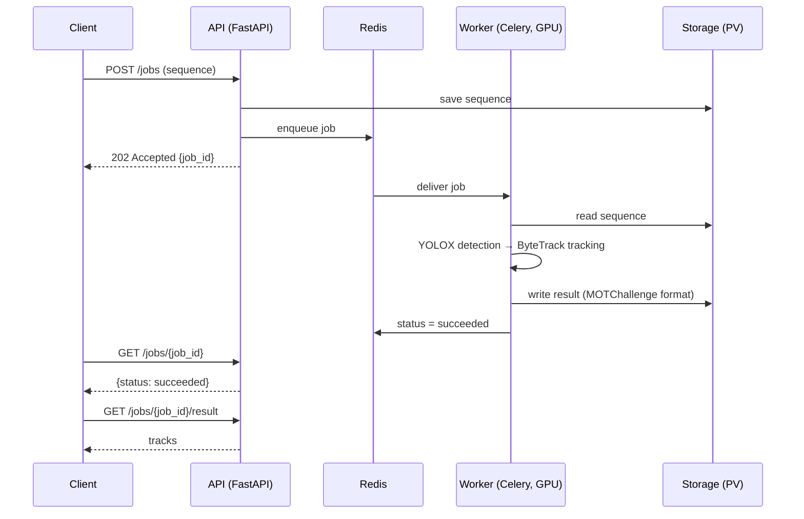
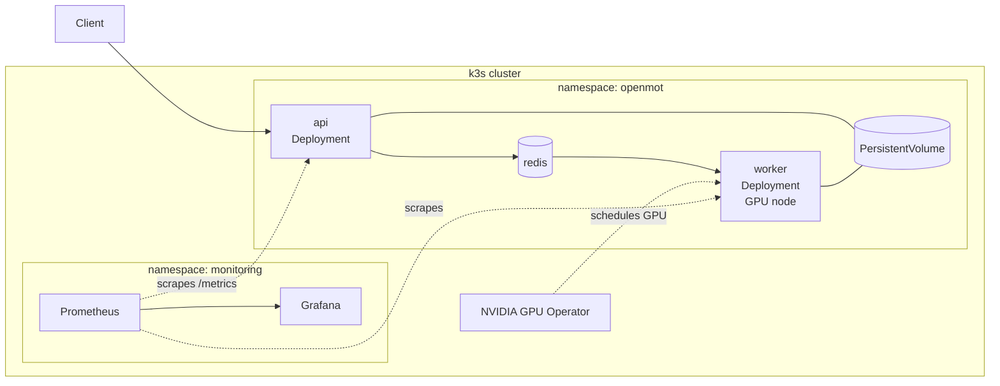

# openmot-serve

Multi-object tracking (MOT17/MOT20) as a production service: FastAPI + Docker + Kubernetes + CI/CD, evaluated with HOTA.

> **Status: planning (pre-v0.1).** Nothing runs yet. Everything below marked _planned_ is the design this repository is being built against. Design decisions live in [`docs/adr/`](docs/adr/); domain terms are defined in [`CONTEXT.md`](CONTEXT.md).

## What this project demonstrates

| Area | Evidence (when complete) |
|---|---|
| Reproducible evaluation | HOTA / MOTA / IDF1 on the MOT17 validation half, re-runnable with one command |
| Model serving | Async tracking-job API with FastAPI, Celery and Redis |
| Containers & Kubernetes | Docker images and k3s manifests with NVIDIA GPU scheduling |
| CI/CD | GitHub Actions: lint, test and build an image on every push |
| Observability | Prometheus metrics and Grafana dashboards for latency, throughput and job failures |
| Inference optimization | Detector INT8 quantization with before/after latency and HOTA |
| Engineering judgement | Detector chosen for license compatibility ([ADR-0001](docs/adr/0001-detector-yolox-for-license.md)) |

## How it works _(planned)_

A client submits a **sequence** (a video or a folder of frames) as a **tracking job**. The API stores the sequence and enqueues the job. A GPU worker detects people with **YOLOX**, links detections into **tracks** with **ByteTrack**, and writes the **result** in MOTChallenge format. The client polls the job until it succeeds, then downloads the result.



## Deployment architecture _(planned, v0.3)_



| Component | Choice | Notes |
|---|---|---|
| API | FastAPI | Async job submission and polling |
| Queue | Celery + Redis | One job per sequence |
| Detector | YOLOX, pretrained COCO weights | Apache-2.0, see ADR-0001 |
| Tracker | ByteTrack | MIT |
| Storage | Kubernetes PersistentVolume | S3-compatible storage later |
| Orchestration | k3s + NVIDIA GPU Operator | Target GPU: RTX 5090 (CUDA 12.8+) |
| Monitoring | Prometheus + Grafana | Latency, throughput, job failures |
| CI | GitHub Actions | Lint, test, build image |

## API _(planned)_

| Method | Path | Description |
|---|---|---|
| `POST` | `/jobs` | Submit a sequence; returns `job_id` with `202 Accepted` |
| `GET` | `/jobs/{job_id}` | Job status: `queued`, `running`, `succeeded`, `failed` |
| `GET` | `/jobs/{job_id}/result` | Tracks in MOTChallenge format (only when `succeeded`) |
| `GET` | `/health` | Liveness / readiness |
| `GET` | `/metrics` | Prometheus metrics |

## Repository layout _(planned)_

```
openmot-serve/
├── app/          # FastAPI service: routes, schemas, job submission
├── worker/       # Celery worker: runs tracking jobs
├── tracking/     # Detection (YOLOX) + tracking (ByteTrack) pipeline
├── eval/         # TrackEval benchmark runs on the MOT17 validation half
├── deploy/
│   ├── docker/   # Dockerfiles, docker-compose
│   └── k8s/      # k3s manifests
├── monitoring/   # Prometheus rules, Grafana dashboards
├── data/         # download_mot.sh (datasets are never committed)
├── tests/
└── docs/
    └── adr/      # Architecture decision records
```

## Evaluation protocol

MOT17 test-set ground truth is not public, so each MOT17 training sequence is split in half:

- **Tuning half** (first half of each sequence): choose tracker parameters
- **Validation half** (second half): report scores with TrackEval

MOT20 is evaluated after v0.5.

## Results _(TBD)_

### Tracking accuracy — MOT17 validation half

| Detector | Tracker | Precision | HOTA | MOTA | IDF1 |
|---|---|---|---|---|---|
| YOLOX | ByteTrack | FP16 | 50.78 | 46.14 | 59.82 |
| YOLOX | ByteTrack | INT8 | TBD | TBD | TBD |

COCO 預訓練權重，未針對 MOT17 微調；數字不可與 ByteTrack 論文並列比較。7 個 FRCNN 訓練序列的合併分數，重現方式見 [`docs/evaluation.md`](docs/evaluation.md)。

### Serving performance — RTX 5090

| Precision | Latency per frame (ms) | Throughput (FPS) | GPU memory (GB) |
|---|---|---|---|
| FP16 | TBD | TBD | TBD |
| INT8 | TBD | TBD | TBD |

### Dashboards

<!-- Grafana screenshot goes here once v0.4 is done -->

## Roadmap

### v0.1 — Tracking pipeline and benchmark
- [x] Verify CUDA / PyTorch on the target GPU (RTX 5090, CUDA 12.8+)
- [x] YOLOX detection + ByteTrack tracking on MOT17 image sequences
- [x] Tuning / validation half split
- [x] HOTA, MOTA, IDF1 on the validation half with TrackEval

### v0.2 — Async service and containers
- [ ] Tracking-job API (`/jobs`, `/jobs/{id}`, `/jobs/{id}/result`)
- [ ] Celery worker + Redis queue
- [ ] Dockerfiles and docker-compose for API, worker and Redis

### v0.3 — Kubernetes
- [ ] k3s manifests: api, worker, redis, persistent volume
- [ ] NVIDIA GPU Operator and GPU scheduling for the worker
- [ ] Health checks and resource limits

### v0.4 — CI/CD and observability
- [ ] GitHub Actions: lint, test, build image on every push
- [ ] Prometheus metrics: request latency, job duration, throughput, failures
- [ ] Grafana dashboard and alert rules

### v0.5 — Inference optimization
- [ ] Export the detector to ONNX / TensorRT
- [ ] INT8 quantization with calibration
- [ ] Before/after comparison of latency, throughput and HOTA

### Later
- [ ] MOT20 benchmark
- [ ] S3-compatible storage
- [ ] Natural-language queries over tracking results (RAG agent)

## Data

```bash
./data/download_mot.sh              # MOT17
./data/download_mot.sh --with-mot20
```

MOTChallenge data are licensed CC BY-NC-SA 3.0 (non-commercial) and are never committed to this repository.

## License

MIT. Third-party components: YOLOX (Apache-2.0), ByteTrack (MIT), TrackEval (MIT).
