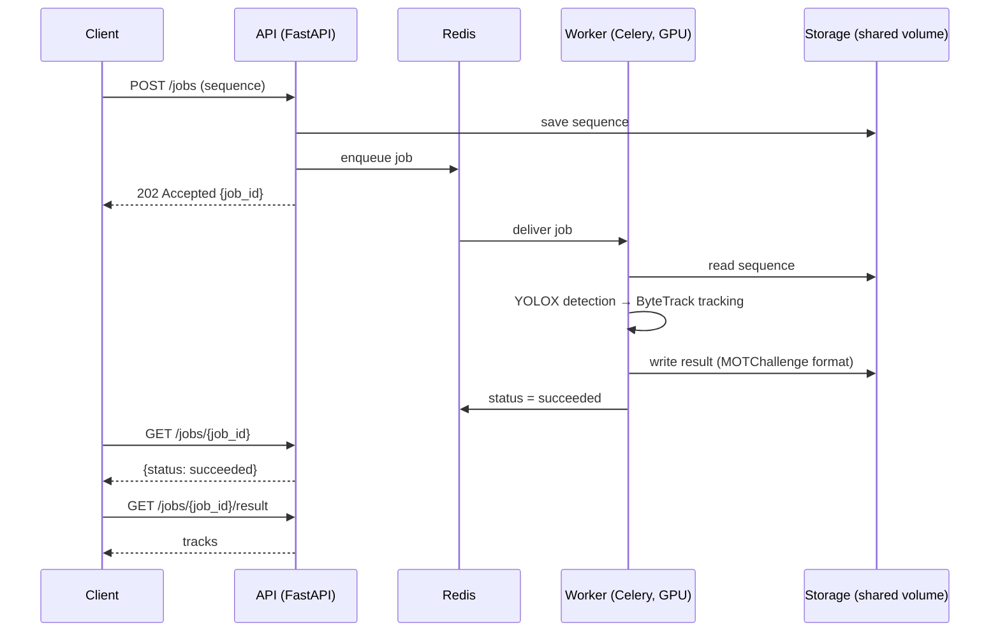
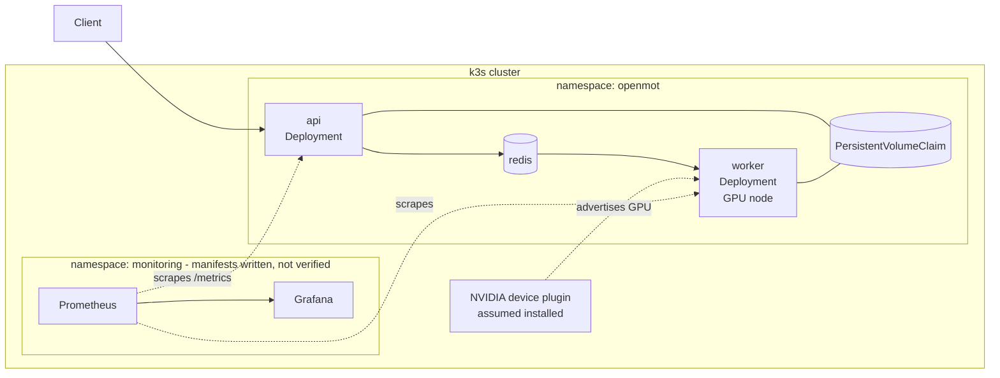
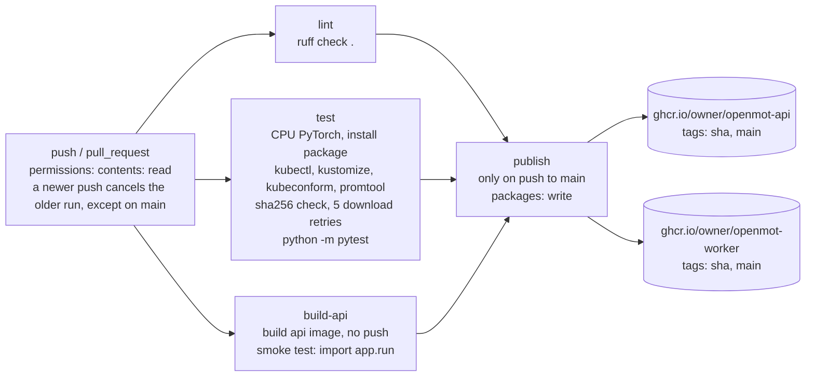

# openmot-serve

Multi-object tracking (MOT17/MOT20) as a production service: FastAPI + Docker + Kubernetes + CI/CD, evaluated with HOTA.

> **Status: v0.2 done; v0.3 in progress — Kubernetes manifests are written but not yet verified on a live cluster; v0.4 CI and observability done — the CI workflow and the GHCR publish have run on GitHub; metrics, a Prometheus/Grafana compose overlay and alert rules are verified end to end except for the worker, which needs a GPU; v0.5 inference optimization done — the detector also runs on ONNX Runtime and TensorRT, and INT8 quantization is measured but not recommended (HOTA 1.51 below FP16); it was served end to end through the Compose TensorRT worker, and GPU memory was measured (Kubernetes has no TensorRT image).** The tracking pipeline and benchmark (v0.1) are unchanged: `python -m eval.run` tunes on the MOT17 tuning half and reports HOTA / MOTA / IDF1 on the validation half (see [`docs/evaluation.md`](docs/evaluation.md)). On top of it, an HTTP API, a Celery GPU worker and a Docker Compose stack are working; see [`docs/service.md`](docs/service.md) for the API, the container deployment and the end-to-end results. The Kubernetes manifests (kustomize base and a k3s single-node overlay) are covered by render and schema tests only; no k3s cluster was available, so deployment, GPU scheduling and pod recovery are not yet verified. [`docs/kubernetes.md`](docs/kubernetes.md) has the prerequisites, the deploy steps and a runbook for verifying them on an external cluster. The GitHub Actions workflow (lint, tests and an api image build on every push) has been run on GitHub-hosted runners and passes; publishing the images to GHCR from `main` has run once successfully (the push is confirmed in the job log; the images have not been pulled back yet). [`docs/ci.md`](docs/ci.md) describes the jobs and how to reproduce them locally. [`docs/observability.md`](docs/observability.md) describes the metrics, the Prometheus and Grafana compose overlay and the alert rules. The worker's metrics have only been tested in-process (the worker needs a GPU, which was not available), the alert thresholds and the dashboard are not calibrated against real traffic, and the Kubernetes monitoring manifests (ServiceMonitor, PrometheusRule) are covered by render and structure tests only, not verified on a live cluster. The worker picks its detector backend with `OPENMOT_BACKEND` (`torch`, `onnx` or `tensorrt`); engines are built and compared with `inference/` and `eval.latency`, and [`docs/evaluation.md`](docs/evaluation.md) has the before/after numbers. The TensorRT worker image exists in Docker Compose only; the Kubernetes manifests run the PyTorch backend. Design decisions live in [`docs/adr/`](docs/adr/); domain terms are defined in [`CONTEXT.md`](CONTEXT.md).

## What this project demonstrates

| Area | Evidence |
|---|---|
| Reproducible evaluation | HOTA / MOTA / IDF1 on the MOT17 validation half, re-runnable with one command |
| Model serving | Async tracking-job API with FastAPI, Celery and Redis |
| Containers & Kubernetes | Docker images and k3s manifests with NVIDIA GPU scheduling |
| CI/CD | GitHub Actions: lint, test and build an image on every push |
| Observability | Prometheus metrics and Grafana dashboards for latency, throughput and job failures |
| Inference optimization | PyTorch, ONNX and TensorRT backends; INT8 quantization with before/after latency and HOTA (measured, judged not recommended) |
| Engineering judgement | Detector chosen for license compatibility ([ADR-0001](docs/adr/0001-detector-yolox-for-license.md)) |
| LLM application _(planned)_ | Natural-language queries over tracking results through a local LLM with tool calling; model selection found no passing local candidate ([report](docs/llm-selection.md)); nothing is served yet |

## How it works

A client submits a **sequence** (a zip of numbered frames) as a **tracking job**. The API stores the sequence and enqueues the job. A GPU worker detects people with **YOLOX**, links detections into **tracks** with **ByteTrack**, and writes the **result** in MOTChallenge format. The client polls the job until it succeeds, then downloads the result.



## Deployment architecture _(v0.3 manifests written, not yet verified; Kubernetes monitoring manifests written, not verified on a cluster)_



| Component | Choice | Notes |
|---|---|---|
| API | FastAPI | Async job submission and polling |
| Queue | Celery + Redis | One job per sequence |
| Detector | YOLOX, pretrained COCO weights | Apache-2.0, see ADR-0001 |
| Inference backend | PyTorch (default), ONNX Runtime, TensorRT | `OPENMOT_BACKEND` and `OPENMOT_PRECISION`; the TensorRT worker image is Compose only, Kubernetes uses PyTorch |
| Tracker | ByteTrack | MIT |
| Storage | Kubernetes PersistentVolumeClaim (k3s `local-path`, single node) | Optional S3-compatible backend for Compose (`OPENMOT_STORAGE_BACKEND=s3`, see [`docs/service.md`](docs/service.md)); Kubernetes stays on the PVC |
| Orchestration | k3s single node + NVIDIA device plugin | GPU Operator is not managed here; target GPU: RTX 5090 (CUDA 12.8+) |
| Monitoring | Prometheus + Grafana | Latency, throughput, job failures; compose overlay; Kubernetes manifests written, not verified on a cluster |
| CI | GitHub Actions | Lint, test, build image |

## CI/CD pipeline



`lint`, `test` and `build-api` run in parallel on every push and pull request. `publish` waits for all three (`needs`), so one failing job skips it, and it runs only for a push to `main`, the only place that holds `packages: write`. The tool downloads in `test` are verified against fixed sha256 values and retried up to five times, which also covers a transient HTTP 403 or 5xx from the download host. The worker image is built and pushed by `publish` but not smoke-tested in CI, and the TensorRT worker image is never built there.

## Quick start

Needs an NVIDIA GPU with the NVIDIA Container Toolkit, Docker Compose v2 and the weights at `models/yolox_x.pth`.

```bash
docker compose -f deploy/docker/docker-compose.yml up -d --build
docker compose -f deploy/docker/docker-compose.yml ps    # wait until all three services are healthy
python -c "import httpx; print(httpx.get('http://127.0.0.1:8000/health').json())"    # {'status': 'ok'}
```

The api is published on the host's `127.0.0.1` only, so other machines cannot reach it directly (it has no authentication or TLS). From another computer, open an SSH tunnel and use `http://127.0.0.1:8000` there:

```bash
ssh -N -L 8000:127.0.0.1:8000 <user>@<this-machine>
```

Submitting a job, the weights location, the environment variables and troubleshooting are in [`docs/service.md`](docs/service.md).

## API

| Method | Path | Description |
|---|---|---|
| `POST` | `/jobs` | Submit a zip of numbered frames; returns `job_id` with `202 Accepted` |
| `GET` | `/jobs/{job_id}` | Job status: `queued`, `running`, `succeeded`, `failed` |
| `GET` | `/jobs/{job_id}/result` | Tracks in MOTChallenge format (only when `succeeded`) |
| `GET` | `/health` | Readiness: `200` when the queue and storage are usable, otherwise `503` with the problems |

Metrics are not part of this API. The api and the worker serve Prometheus metrics on their own ports (9101 and 9102) that are not published to the host; see [`docs/observability.md`](docs/observability.md).

## Repository layout

```
openmot-serve/
├── app/          # FastAPI service: routes, upload validation, entrypoint
├── jobs/         # Job records, state machine, Redis store, settings, storage layout
├── worker/       # Celery worker: job processing, startup checks, healthcheck
├── tracking/     # Detection (YOLOX) + tracking (ByteTrack) pipeline
├── inference/    # ONNX export, TensorRT engine build, INT8 calibration, backend loading
├── eval/         # TrackEval benchmark runs on the MOT17 validation half, latency measurement
├── metrics/      # Prometheus metric definitions and the metrics HTTP server
├── deploy/
│   ├── docker/   # Dockerfiles, docker-compose
│   └── k8s/      # kustomize base + k3s single-node overlay
├── .github/workflows/  # CI: lint, test, api image build, publish from main
├── monitoring/   # Prometheus config and alert rules, Grafana dashboard (compose overlay)
├── data/         # download_mot.sh (datasets are never committed)
├── scripts/      # fake_service.py (in-memory API demo) and local helper scripts
├── openspec/     # Specs and archived changes (spec-driven workflow)
├── tests/
├── CONTEXT.md    # Domain terms
└── docs/
    └── adr/      # Architecture decision records
```

## Evaluation protocol

MOT17 test-set ground truth is not public, so each MOT17 training sequence is split in half:

- **Tuning half** (first half of each sequence): choose tracker parameters
- **Validation half** (second half): report scores with TrackEval

MOT20 uses the same protocol on its four labelled training sequences (`MOT20-01`, `02`, `03`, `05`), scored with TrackEval's MOT20 convention. Its tracker parameters are reused from the MOT17 run rather than tuned on MOT20, see the MOT20 results below.

## Results

### Tracking accuracy — MOT17 validation half

| Detector | Tracker | Precision | HOTA | MOTA | IDF1 |
|---|---|---|---|---|---|
| YOLOX | ByteTrack | FP16 | 50.78 | 46.14 | 59.82 |
| YOLOX | ByteTrack | INT8 | 49.27 | 45.13 | 58.14 |

COCO 預訓練權重，未針對 MOT17 微調；數字不可與 ByteTrack 論文並列比較。7 個 FRCNN 訓練序列的合併分數，重現方式見 [`docs/evaluation.md`](docs/evaluation.md)。FP16 列是 PyTorch；INT8 列是 TensorRT 訓練後量化（INT8 搭配 FP16），HOTA 比 PyTorch FP16 低 1.51，超過事先訂下的 1.0 門檻，所以標為不建議。

### Tracking accuracy — MOT20 validation half

| Detector | Tracker | Precision | HOTA | MOTA | IDF1 |
|---|---|---|---|---|---|
| YOLOX | ByteTrack | FP16 | 33.90 | 37.06 | 46.58 |

PyTorch FP16，4 個訓練序列（`MOT20-01`、`02`、`03`、`05`）的合併分數。追蹤器參數沿用 MOT17 FP16 那次調出的值（`--params data/results/full-fp16-3/params.json`），未針對 MOT20 調整，所以 MOT20 的 Tuning Half 沒有被使用；MOT20 是高密度人群，這組參數在這裡不一定最佳。偵測器是 COCO 預訓練權重，未微調；數字不可與 ByteTrack 論文並列比較，也不可與上表 MOT17 的數字視為同一個條件下的比較。計分用 TrackEval 的 MOT20 慣例（`non_mot_vehicle` 與其他干擾物一樣被忽略）。兩次執行（`mot20-fp16-3`、`mot20-fp16-4`）的分數與結果檔逐位元組相同，但兩次的偵測都來自快取（推論只在較早、已被取代的一次跑過），並沒有重新推論。MOT20 的延遲與吞吐量未量測，ONNX、TensorRT、INT8 也沒有 MOT20 的數字。每個序列的分數與重現方式見 [`docs/evaluation.md`](docs/evaluation.md)。

### Serving performance — RTX 5090

| Precision | Latency per frame (ms) | Throughput (FPS) | GPU memory (MiB) |
|---|---|---|---|
| FP16 (PyTorch) | 18.1 | 55.2–55.3 | 1360 |
| FP16 (TensorRT) | 10.4–10.6 | 90.1–90.8 | 1018 |
| INT8 (TensorRT) | 7.4–7.7 | 122.1–130.5 | 886 |

延遲是端到端（前處理、推論、後處理）的中位數，範圍是連續兩次量測的最小到最大，每次 500 張、batch 1、單串流（PyTorch FP16 的最初基準為 18.2–18.3 ms，表中是與 TensorRT 同期重跑的數字）。GPU memory 是量測結束後相對於載入前的整張 GPU 已用量增量，用 `nvidia-smi` 在閒置的 GPU 上讀取，含該程序的 CUDA context 與配置器快取，不是模型權重的大小；每個設定量兩次，兩次的數字相同。細節與限制見 [`docs/evaluation.md`](docs/evaluation.md)。

### Dashboards

The Grafana dashboard is provisioned by the Compose monitoring overlay (see [`docs/observability.md`](docs/observability.md)). No screenshot has been captured yet, and the panels are not calibrated against real traffic.

## Roadmap

### v0.1 — Tracking pipeline and benchmark
- [x] Verify CUDA / PyTorch on the target GPU (RTX 5090, CUDA 12.8+)
- [x] YOLOX detection + ByteTrack tracking on MOT17 image sequences
- [x] Tuning / validation half split
- [x] HOTA, MOTA, IDF1 on the validation half with TrackEval

### v0.2 — Async service and containers
- [x] Tracking-job API (`/jobs`, `/jobs/{id}`, `/jobs/{id}/result`)
- [x] Celery worker + Redis queue
- [x] Dockerfiles and docker-compose for API, worker and Redis

### v0.3 — Kubernetes
- [x] k3s manifests: api, worker, redis, persistent volume (kustomize base + k3s overlay; render and schema tests only)
- [x] Health checks and resource limits (probes declared; resource values are uncalibrated)
- [ ] GPU scheduling for the worker (`nvidia.com/gpu` request is declared; scheduling is unverified, and the NVIDIA GPU Operator is out of scope — a device plugin is assumed)
- [ ] Verify the deployment, GPU scheduling and pod recovery on a live k3s cluster (runbook in [`docs/kubernetes.md`](docs/kubernetes.md))

### v0.4 — CI/CD and observability
- [x] GitHub Actions: lint, test, build image on every push (verified on GitHub-hosted runners)
- [x] Publish the api and worker images to GHCR from `main` (ran once on `main`; push confirmed in the job log)
- [x] Prometheus metrics: request latency, job duration, throughput, failures, queue depth (api metrics verified end to end; worker metrics tested in-process only, no GPU available)
- [x] Grafana dashboard and alert rules (compose overlay, rules unit-tested with promtool; thresholds not calibrated against real traffic, no Alertmanager)
- [x] Kubernetes monitoring manifests (ServiceMonitor, monitoring namespace; manifests, render and structure tests only; not verified on a live cluster)

### v0.5 — Inference optimization
- [x] Latency and throughput baseline for the detector (`python -m eval.latency`; PyTorch FP16 on an RTX 5090: 11.2 ms inference, 18.2–18.3 ms end to end, about 55 FPS in the first baseline runs; 18.1 ms when re-measured alongside the TensorRT runs — see [`docs/evaluation.md`](docs/evaluation.md))
- [x] Export the detector to ONNX / TensorRT (`python -m inference.export_onnx`, `python -m inference.build_engine`, then `--backend onnx|tensorrt`; TensorRT FP16 on an RTX 5090: 4.8 ms inference, 10.5 ms end to end, about 91 FPS, combined HOTA 50.85 against 50.78 for PyTorch FP16 — see [`docs/evaluation.md`](docs/evaluation.md))
- [x] INT8 quantization with calibration (`python -m inference.build_engine --precision int8`; TensorRT post-training quantization calibrated on 512 Tuning Half frames; 2.8 ms inference, 7.4–7.7 ms end to end on an RTX 5090, but combined HOTA 49.27 is 1.51 below PyTorch FP16, so it is not recommended; served end to end through the Compose TensorRT worker, 886 MiB of GPU memory after a run — see [`docs/evaluation.md`](docs/evaluation.md))
- [x] Before/after comparison of latency, throughput and HOTA (PyTorch FP16 → TensorRT FP16 → TensorRT INT8; GPU memory is whole-GPU used memory measured with `nvidia-smi`)

### Later
- [x] MOT20 benchmark (PyTorch FP16 on the validation half, tracker parameters reused from MOT17; see [`docs/evaluation.md`](docs/evaluation.md))
- [x] S3-compatible storage (optional backend, Compose only; verified end to end against a pinned RustFS image (`rustfs/rustfs:1.0.6`), not MinIO or AWS S3; see [`docs/service.md`](docs/service.md))
- [ ] LLM agent for natural-language queries over tracking results (tool calling with a local LLM; the answers are computed by code from `result.txt`, so there is no vector retrieval, and the earlier "RAG agent" name no longer applies). Local model selection is done and no candidate passed the thresholds (see [docs/llm-selection.md](docs/llm-selection.md)); the agent itself is not built

## Data

```bash
./data/download_mot.sh              # MOT17
./data/download_mot.sh --with-mot20
```

MOTChallenge data are licensed CC BY-NC-SA 3.0 (non-commercial) and are never committed to this repository.

## License

MIT. Third-party components: YOLOX (Apache-2.0), ByteTrack (MIT), TrackEval (MIT).
